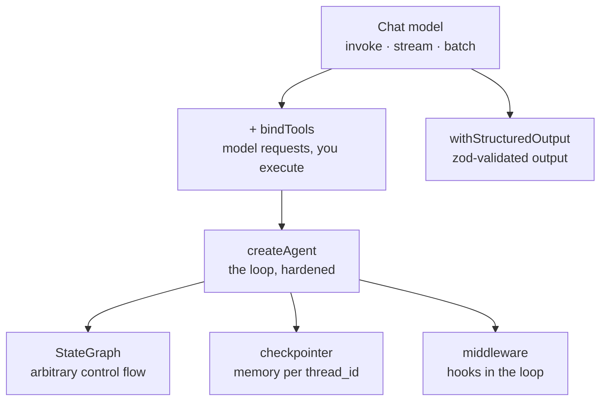

# LangChain.js — a hands-on course

Ten runnable TypeScript lessons, each one a single file you read top-to-bottom
and then run. Written against **LangChain v1** (`langchain@1.5`), whose API is
substantially different from the v0.x tutorials that dominate search results.

Every lesson here has been executed against a live model. No pseudocode.

## Setup

```bash
pnpm install
cp .env.example .env     # then fill in one provider
pnpm 01
```

The repo is provider-agnostic. `src/model.ts` resolves the provider once from
`.env`; nothing else in the course mentions a vendor. Supported out of the box:

| Option | Set in `.env` |
|---|---|
| Any OpenAI-compatible gateway | `OPENAI_API_KEY` + `OPENAI_BASE_URL` + `LC_MODEL` |
| OpenAI | `OPENAI_API_KEY` |
| Anthropic | `ANTHROPIC_API_KEY` |
| Google Gemini | `GOOGLE_API_KEY` |
| Ollama (local, no key) | `OLLAMA_MODEL=qwen3:8b` |

Lessons 05–08 and 10 need a model with **tool calling**. Lesson 08 also needs an
**embedding** model.

## Lessons

| # | Run | Topic | What you learn |
|---|---|---|---|
| 01 | `pnpm 01` | First call | `invoke` / `batch`; why you get an `AIMessage`, not a string; `.text` vs `.content` vs `.contentBlocks`; token accounting |
| 02 | `pnpm 02` | Messages & prompts | The four message types; **a conversation is an array you resend**; `ChatPromptTemplate` + `.pipe()` |
| 03 | `pnpm 03` | Streaming | `AIMessageChunk` deltas; `.concat()` to rebuild a whole message; why string-joining loses tool calls and reasoning |
| 04 | `pnpm 04` | Structured output | `.withStructuredOutput(zodSchema)`; `.describe()` as prompt text; `includeRaw`; classification |
| 05 | `pnpm 05` | Tools | `tool()`, `bindTools`, `tool_calls`, `ToolMessage` + `tool_call_id` — **the agent loop written by hand** |
| 06 | `pnpm 06` | Agents | `createAgent`; the full message trace; `responseFormat`; `streamMode`; `recursionLimit` |
| 07 | `pnpm 07` | Memory | `MemorySaver` + `thread_id`; thread isolation; `agent.graph.getState`; `summarizationMiddleware`; custom `createMiddleware` |
| 08 | `pnpm 08` | RAG | Load → split → embed → store → retrieve; naive RAG vs **agentic RAG** (retrieval as a tool) |
| 09 | `pnpm 09` | LangGraph | `StateSchema` + `StateGraph`; conditional edges; a real **critique/retry cycle**; path maps |
| 10 | `pnpm chat` | Capstone | Interactive CLI agent: 4 tools, streaming, persistent memory, middleware |

Run them in order. Each ends by naming the next.

## The mental model

Three layers, and the course walks up them:



Four ideas do most of the work:

1. **Models are stateless.** Memory is state *you* persist and replay. Lesson 02
   proves it; lesson 07 automates it.
2. **The model never executes anything.** It emits `{name, args, id}` and your
   code decides what to run. Lesson 05 writes that dispatch loop by hand.
3. **An agent is a while-loop.** `createAgent` is that loop plus limits, retries,
   streaming and checkpointing — not magic. Lesson 06.
4. **When the loop is the wrong shape, drop to the graph.** `createAgent`
   compiles to LangGraph; lesson 09 builds a graph directly for branch-and-retry
   workflows a tool loop cannot express.

## Gotchas this course covers

Things that cost real debugging time:

- `await model.stream(...)` — **double await**. It returns a Promise of an async iterable.
- `maxTokens` includes hidden reasoning tokens. Set it too low on a reasoning model and `.text` comes back empty.
- `MemoryVectorStore` moved to `@langchain/classic/vectorstores/memory`. `langchain/vectorstores/memory` no longer exists in v1.
- `agent.getState()` is `@internal` and typed `never`. Use `agent.graph.getState()`.
- The agent's model node is named `model_request`, not `model` — matters when filtering `streamMode: "messages"`.
- Every tool call **must** get a `ToolMessage` back, or the next request errors.
- Passing the whole `tool_call` object to `tool.invoke(call)` returns a `ToolMessage` with the `tool_call_id` already attached. Do that instead of constructing one.
- `addConditionalEdges` without a path map makes LangGraph assume every node is reachable.
- Tool descriptions are a hint; a system prompt is policy. Weaker models will ask the user for data a tool could supply unless you forbid it.

## Verify everything typechecks

```bash
pnpm typecheck
```

## Optional: see inside every call

Set `LANGSMITH_TRACING=true` and `LANGSMITH_API_KEY` in `.env` to get a full
trace of every model call, tool call, and graph step at
[smith.langchain.com](https://smith.langchain.com).

## Reference

- [LangChain JS docs](https://docs.langchain.com/oss/javascript/langchain/overview)
- [API reference](https://reference.langchain.com/javascript/)
- [LangGraph JS](https://docs.langchain.com/oss/javascript/langgraph/graph-api)
